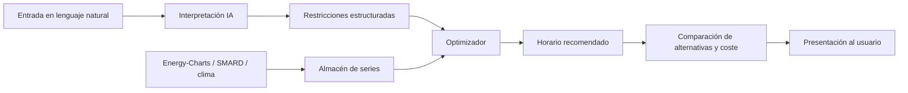

# Volty

Plataforma de planificación y recomendación para analizar y optimizar el consumo de energía eléctrica a partir de datos energéticos reales.

---

## 3. Optimización inteligente del consumo energético

### Descripción

El proyecto consiste en desarrollar una plataforma para analizar y optimizar el consumo de energía eléctrica utilizando información energética real.

El sistema permitirá al usuario registrar diferentes dispositivos o cargas eléctricas y establecer sus necesidades y restricciones. Por ejemplo, se podrá indicar que un vehículo eléctrico necesita alcanzar determinada cantidad de energía antes de una hora específica.

A partir de estas condiciones, el sistema analizará los precios y las condiciones del mercado energético para determinar los momentos más convenientes para realizar cada consumo.

El objetivo es ayudar al usuario a desplazar consumos flexibles hacia periodos potencialmente más económicos y, adicionalmente, considerar la disponibilidad de fuentes renovables.

### Inteligencia Artificial

La inteligencia artificial se utilizará como una interfaz de interacción con el usuario.

El usuario podrá expresar sus necesidades mediante lenguaje natural, por ejemplo:

> "Necesito cargar el vehículo antes de las 7 de la mañana y quiero minimizar el coste."

El sistema podrá interpretar esta solicitud y convertirla en restricciones estructuradas para el proceso de optimización.

La generación del horario final estará basada en las restricciones y los datos energéticos disponibles, permitiendo comparar el coste estimado del horario propuesto con otras alternativas.

Como posible extensión, se podrá utilizar inteligencia artificial o modelos predictivos para estimar la evolución futura de precios o generación renovable.

### Información y APIs externas

El sistema utilizará información energética real procedente de fuentes públicas.

Entre las principales fuentes consideradas se encuentran:

- **Energy-Charts** (Fraunhofer Institute for Solar Energy Systems, Fraunhofer ISE): precios, generación eléctrica, fuentes renovables e indicadores del sistema energético.
- **SMARD** (Bundesnetzagentur, Alemania): mercado eléctrico, generación y consumo.
- **APIs meteorológicas públicas** (complementarias): variables climáticas relacionadas con generación renovable.

La información obtenida de estas fuentes será almacenada y procesada para permitir el análisis histórico y la generación de planes de consumo.

### Alcance

| Incluido | Excluido |
|----------|----------|
| Registro de cargas y restricciones | Control directo de dispositivos físicos |
| Planificación y recomendación de horarios | Automatización de electrodomésticos, VE, baterías, etc. |
| Comparación de costes entre alternativas | |
| Uso de datos de mercado y renovables | |

El sistema funcionará como una herramienta de planificación y recomendación. Las recomendaciones se calcularán a partir de la información energética disponible y de las restricciones proporcionadas por el usuario.

---

## Modelo conceptual (borrador)

### Entidades principales

- **Usuario / hogar**: conjunto de cargas y preferencias globales (por ejemplo, priorizar coste vs. renovables).
- **Carga (dispositivo)**: potencia máxima, energía objetivo, ventana temporal, flexibilidad (continua vs. intervalos).
- **Restricción**: deadline, energía mínima/máxima, horas prohibidas, preferencias declaradas en NL → JSON/schema.
- **Plan / horario**: asignación de potencia o energía por intervalo de tiempo (p. ej. cuartos de hora).
- **Serie temporal**: precios, generación renovable, demanda — ingeridas desde APIs y cacheadas localmente.

### Flujo de alto nivel



### Optimización (enfoque inicial)

Sin control físico, el núcleo puede ser un problema de asignación en ventana temporal:

- **Objetivo**: minimizar coste estimado (o multi-objetivo: coste + penalización por baja renovable).
- **Restricciones**: energía total ≥ objetivo antes del deadline; límites de potencia; no solapamiento incompatible entre cargas (opcional).
- **Entrada**: vector de precios (y opcionalmente señal de intensidad de renovables) por intervalo.
- **Salida**: plan por carga + coste total vs. baseline (p. ej. carga inmediata o uniforme).

La IA no sustituye al optimizador: traduce intención del usuario → parámetros; el horario final debe ser reproducible y auditable.

---

## Referencias útiles

- Energy-Charts: https://energy-charts.info/
- SMARD: https://www.smard.de/en

---

## Próximos pasos sugeridos

1. Definir schema de restricciones (JSON) que la IA debe emitir y el optimizador consumir.
2. Elegir mercado/región inicial (p. ej. Alemania por SMARD/Energy-Charts) e intervalo de resolución temporal.
3. Implementar ingesta + cache de precios day-ahead para el horizonte de planificación.
4. MVP: una carga (VE) + optimizador greedy o LP + UI mínima; después, chat NL y comparativas.

---

## Estado de implementación

| Ítem | Estado | Notas |
|------|--------|--------|
| Schema JSON de restricciones | Hecho | `docs/schemas/optimize-request.schema.json` |
| Mercado DE-LU, intervalos 15 min | Hecho | Energy-Charts `/v2/price` |
| Ingesta + caché de precios | Hecho | Energy-Charts; caché TTL en PostgreSQL |
| Optimizador LP + baselines | Hecho | ASAP y uniforme; multi-carga independiente |
| API interpret NL | Hecho | Reglas ES + OpenAI opcional |
| UI planificación | Hecho | Relieve (`DESING.md`) — Tailwind v4, franja, chips IA |
| SMARD (series mercado) | Hecho | `GET /api/smard/series` |
| Histórico persistente (BD) | Hecho | PostgreSQL (`docker compose`) + `ingested_snapshots` |
| Multi-carga con límite de potencia hogar | Pendiente | |
| Predicción precios / renovables | Pendiente | Extensión IA |
| Infra AWS (Terraform + Lambdas) | Pendiente | Ver sección 53+ |
| CI/CD GitHub Actions | Pendiente | Lint, test, plan/apply, migraciones |

---

## 53. Arquitectura de despliegue (obligatoria)

El despliegue debe ser **reproducible con Terraform**. No crear recursos AWS a mano en consola salvo configuración inicial de cuenta que no pueda ir en Terraform.

Despliegue objetivo desde un entorno limpio:

```text
Terraform + GitHub Actions
```

Servicios permitidos en el MVP (sin inflar coste):

| Usar | Evitar (salvo necesidad demostrada) |
|------|-------------------------------------|
| Lambda, API Gateway, RDS PostgreSQL | NAT Gateway, Kubernetes, servidores 24/7 |
| EventBridge (solo ingesta programada) | SQS, SNS, Step Functions, streaming |
| CloudWatch Logs | Plataforma observability compleja |
| IAM mínimo | `AdministratorAccess` en Lambdas |
| Terraform (estado remoto si es posible) | `terraform.tfstate` en Git |

**Principio:** la nube demuestra serverless + persistencia gestionada + IaC + CI/CD, no “cuántos servicios AWS encadenamos”.

### 53.1 Lambdas (pocas, por responsabilidad)

No una Lambda por endpoint. Funciones lógicas iniciales:

```text
api                 → API pública (FastAPI/Mangum o handler HTTP)
optimization        → optimizador determinista
ai-interpreter      → NL → JSON validado
data-ingestion      → Energy-Charts (+ SMARD opcional)
```

| Lambda | Responsabilidad | NO debe |
|--------|-----------------|--------|
| **api** | Auth, cargas, dashboard, orquestar interpret/run, leer resultados | Contener lógica pesada de LP ni llamadas LLM directas en caliente sin acotar |
| **optimization** | Cargar series normalizadas, validar restricciones, LP, baselines, ahorro, persistir resultado | Llamar al LLM |
| **ai-interpreter** | LLM → JSON → validación schema | Escribir horarios, optimizar, acceso amplio a BD |
| **data-ingestion** | EventBridge → APIs externas → normalizar → PostgreSQL | Ejecutarse en bucle continuo |

Flujo interpretación:

```text
Frontend → API Gateway → API Lambda → invoke AI Lambda → schema OK → respuesta
```

Flujo optimización:

```text
API Lambda → invoke Optimization Lambda → RDS → resultado
```

Ingesta:

```text
EventBridge (cron configurable en Terraform)
    → Data Ingestion Lambda
    → Energy-Charts (SMARD opcional)
    → PostgreSQL
```

Ejemplo de schedule: diario, precios day-ahead del día siguiente. Sin polling continuo.

### 53.2 Empaquetado y configuración (detalle para implementación)

Cada Lambda lleva **solo sus dependencias** (evitar layers gigantes “por arquitectura”). Terraform debe definir explícitamente:

- Runtime, memoria, timeout (conservadores; subir con métricas).
- Variables de entorno (no secretos en código).
- Rol IAM propio.
- VPC **solo** donde haga falta RDS.
- Permisos de invoke entre Lambdas (API → AI, API → optimization).
- Log group CloudWatch.

Timeouts explícitos en **httpx** hacia Energy-Charts/SMARD/LLM. Si Lambda hace timeout → error controlado, sin reintentos infinitos.

**Orden lógico de creación Terraform** (dependencias, sin `sleep` manuales):

```text
IAM → Networking (VPC/subnets si aplica) → RDS → Lambda → API Gateway → EventBridge → CloudWatch
```

**Migraciones:** Alembic (u herramienta del backend) en el pipeline **después** del deploy de código, **antes** del smoke test. No crear tablas a mano en producción. No Lambda de migración salvo necesidad real.

**Secretos:**

| Entorno | Mecanismo |
|---------|-----------|
| Local | `backend/.env` / `.env.local` (gitignored) |
| Producción | Secrets Manager / SSM Parameter Store (según Terraform) |

Placeholders en `.env.example`: `DATABASE_URL`, `JWT_SECRET`, `AI_API_KEY`.

### 53.3 API Gateway

Exponer solo la **API Lambda**. Rutas orientativas:

```text
/api/v1/dashboard
/api/v1/energy/prices
/api/v1/loads
/api/v1/optimization/interpret
/api/v1/optimization/run
```

AI y optimization **no** públicas; invocación directa desde API Lambda (MVP). Sin colas extra.

### 53.4 RDS PostgreSQL

Fuente de verdad: usuarios, cargas, puntos de precio/generación, peticiones y resultados de optimización, slots de horario, metadatos de ingesta.

**Red (decisión explícita antes de Terraform):**

```text
Lambda (en VPC) → RDS privado (sin PostgreSQL público)
```

Si una Lambda necesita **RDS + internet** (p. ej. ingesta), evaluar diseño **antes** de añadir NAT Gateway (coste). Documentar la opción elegida en Terraform (p. ej. subnets, endpoints, o ingesta solo desde Lambda con ruta saliente justificada).

### 53.5 CI/CD (GitHub Actions)

**Pull request:** lint → typecheck → unit tests → (opcional) security scan.

**Main:** tests → build paquetes Lambda → `terraform validate` → `plan` → `apply` → migraciones → smoke test.

No desplegar desde estado local no verificado. No commitear `terraform.tfstate`.

**Frontend:** hosting estático separado (S3+CloudFront, Netlify, etc.); no EC2 solo por servir SPA.

**Entornos:** mínimo `local` + `production`; staging opcional.

### 53.6 Validación post-despliegue (smoke)

Comprobar que no basta con “Terraform OK”:

- Frontend carga.
- API Gateway responde.
- Conexión RDS desde API Lambda.
- Existen datos de precios ingeridos.
- `/optimization/run` devuelve plan + ahorro.
- Interpret NL devuelve JSON válido.
- Job EventBridge ejecutó ingesta (log + filas nuevas).
- Logs CloudWatch sin secretos (nunca JWT, API keys, passwords).

Logging estructurado recomendado: `requestId`, operación, duración, status, `errorType`, proveedor externo.

### 53.7 Diagrama producción (referencia)

```text
                       ┌───────────────┐
                       │   Frontend    │
                       └───────┬───────┘
                               │
                               ▼
                       ┌───────────────┐
                       │ API Gateway   │
                       └───────┬───────┘
                               │
                               ▼
                       ┌───────────────┐
                       │  API Lambda   │
                       └───┬─────┬─────┘
                           │     │
                ┌──────────┘     └──────────┐
                ▼                           ▼
        ┌───────────────┐           ┌───────────────┐
        │  AI Lambda    │           │ Optimizer     │
        └───────────────┘           │ Lambda        │
                                    └───────┬───────┘
                                            ▼
                                     ┌─────────────┐
                                     │ RDS Postgres│
                                     └─────────────┘

                  EventBridge → Data Ingestion Lambda → APIs externas
```

---

## 54. Refactorización respecto al repo actual

Hoy el MVP es un **monolito FastAPI** (`uvicorn`, un proceso, todas las rutas en `backend/volty/api/routes.py`). Eso acelera desarrollo local; **no** es la forma objetivo de producción.

| Hoy | Objetivo |
|-----|----------|
| Un solo `main.py` + `routes.py` | Cuatro handlers Lambda + API Gateway |
| Ingesta en petición HTTP (`fetch_prices` cache miss) | Ingesta **solo** en `data-ingestion` + EventBridge; API lee RDS |
| NL en proceso API (`nl_interpreter.py`) | Módulo compartido invocado desde **AI Lambda**; API solo orquesta |
| Optimizer en proceso API | Paquete `volty.optimizer` en **Optimization Lambda** |
| `PostgresCacheStore` + snapshots en misma app | Misma BD; escritura de ingesta restringida al worker |
| Sin auth | JWT en **API Lambda** (`JWT_SECRET`) |
| Docker Compose Postgres local | RDS en prod; Compose/local solo para dev |
| Sin `infra/` | Carpeta `infra/terraform/` (módulos: network, rds, lambda, apigw, eventbridge, iam) |
| Sin CI deploy | `.github/workflows/` (ci.yml + deploy.yml) |

**Paquetes Python sugeridos (extracción gradual):**

```text
backend/volty/
  core/           # schemas, config, db models (compartido)
  optimizer/      # LP + baselines (optimization Lambda)
  interpreter/    # NL + validación schema (AI Lambda)
  ingestion/      # energy_charts, smard, normalización (data-ingestion)
  api/            # rutas HTTP, auth, invoke otros handlers (API Lambda)
```

**Orden de refactor recomendado (alineado con commits):**

1. ~~Extraer módulos sin cambiar comportamiento (core / optimizer / interpreter / ingestion).~~ **Hecho** — ver `backend/volty/{core,optimizer,interpreter,ingestion,api}/`.
2. Añadir tablas normalizadas de precios (más allá de JSONB snapshot) para el optimizador.
3. Script o Lambda `data-ingestion` + regla EventBridge (local: cron manual o `make ingest`).
4. Handlers Lambda finos + tests unitarios por paquete.
5. Terraform mínimo (RDS + una API Lambda + Gateway) y ampliar.
6. GitHub Actions: test en PR; deploy en main.

Cualquier IA que implemente infra debe seguir esta sección **antes** de proponer NAT, colas o microservicios extra.
